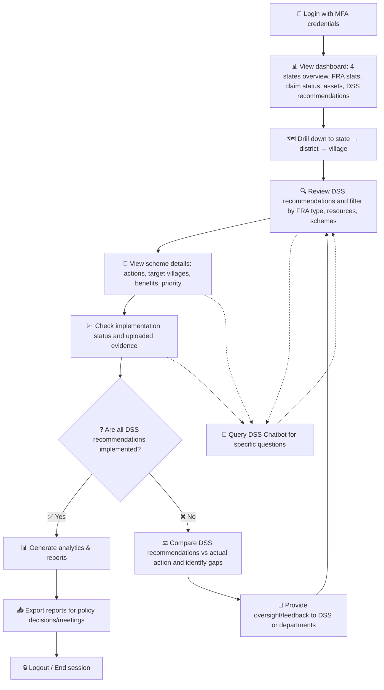
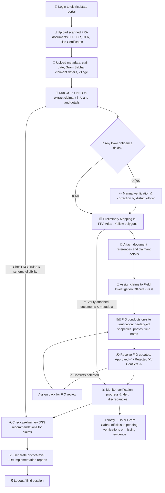
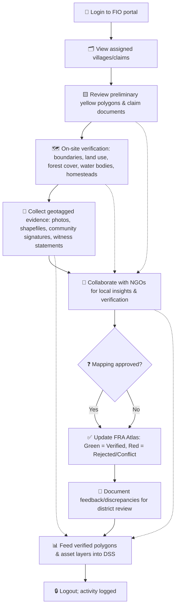
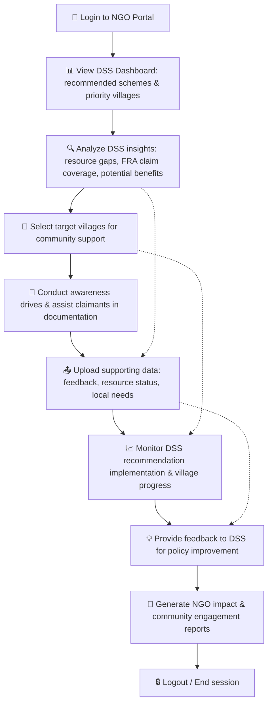
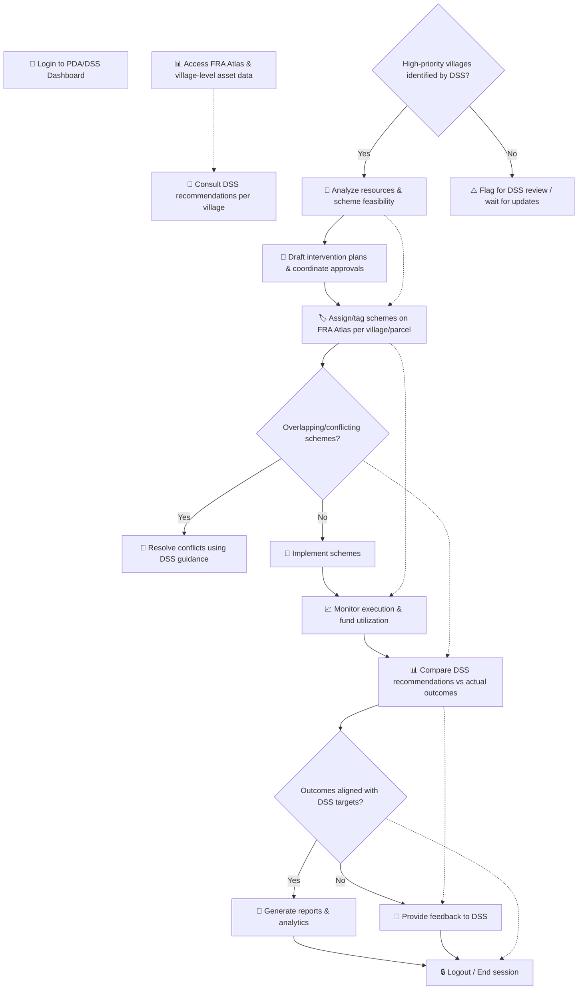

# FRA Atlas User Workflows

This document contains the Mermaid workflow diagrams for all user types in the FRA Atlas system. It also highlights how different users collaborate and utilize the DSS for scheme planning and FRA implementation.

---

## Table of Contents

1. [Website Overview: FRA Atlas & DSS System](#fra-atlas--dss-system-website-workflow)
2. [Central Government (Ministry of Tribal Affairs)](#1-central-government-ministry-of-tribal-affairs)
3. [District-Level Tribal Welfare Departments & Line Departments of DAJGUA](#2-district-level-tribal-welfare-departments--line-departments-of-dajgua)
4. [Field Investigation Officer (FIO)](#3-field-investigation-officer-fio)
5. [NGOs Working with Tribal Communities](#4-ngos-working-with-tribal-communities)
6. [Planning & Development Authorities](#5-planning--development-authorities)

---

## FRA ATLAS & DSS SYSTEM WEBSITE WORKFLOW

```mermaid
flowchart TD
    %% PDA & DSS Portal Workflow
    A[🔑 Login to PDA Portal / DSS Dashboard] --> B[🗺️ Access verified FRA Atlas & village-level asset data]
    B --> C[📊 Analyze DSS recommendations: schemes, priorities, resource gaps]
    C --> D[🔍 Filter villages by need, FRA type, and existing interventions]
    D --> E[🎯 Select priority villages for scheme planning]
    E --> F[📝 Formulate development action plans using DSS insights]
    F --> G[🤝 Coordinate with District & Line Departments for approvals & resource allocation]
    G --> H[🏷️ Assign schemes to villages / tag parcels on FRA Atlas]
    H --> I[📈 Monitor scheme implementation and fund utilization]
    I --> J[📊 Compare DSS recommendations vs actual outcomes]
    J --> K[📑 Generate analytics, reports, & feedback to DSS]
    K --> L[🔒 Logout / End session]

    %% Central Govt
    CG[🏛️ Central Govt] -->|📡 Monitor progress| D[🏢 District Officials]
    CG -->|📤 Receive DSS reports| PDA[🏛️ Planning & Development Authorities]

    %% District Officials
    D1[🔑 Login to portal] --> D2[📂 Upload FRA docs: claims & title certificates]
    D2 --> D3[📝 Run OCR + NER to extract claimant & land data]
    D3 --> D4{❓ Low-confidence fields?}
    D4 -- Yes --> D5[✏️ Manual correction]
    D4 -- No --> D6[🗺️ Preliminary FRA Atlas mapping - yellow]
    D6 --> D7[📤 Assign claims to FIOs]
    D7 --> D8[📊 Monitor FIO progress & receive verification updates]

    %% Field Investigation Officers
    FIO1[🔑 FIO Login & view assigned claims] --> FIO2[📍 On-site verification]
    FIO2 --> FIO3[📸 Collect geotagged photos, shapefiles, evidence]
    FIO3 --> FIO4{✅ Claim valid?}
    FIO4 -- Yes --> FIO5[🟢 Approve mapping - Green in FRA Atlas]
    FIO4 -- No --> FIO6[🔴 Reject / mark conflict - Red]
    FIO5 & FIO6 --> FIO7[📝 Upload field notes & feedback]

    %% DSS & Planning Authorities
    PDA1[🔑 PDA Login & access verified FRA Atlas] --> PDA2[📊 Consult DSS recommendations]
    PDA2 --> PDA3[🎯 Prioritize villages & plan interventions]
    PDA3 --> PDA4[🤝 Coordinate with districts for approvals & resource allocation]
    PDA4 --> PDA5[📈 Monitor implementation & compare DSS vs actual outcomes]
    PDA5 --> PDA6[📑 Feedback to DSS & generate reports]
    PDA6 --> CG

    %% NGOs
    NGO1[🔑 NGO Login & access FRA Atlas + DSS] --> NGO2[🔍 Identify high-need villages]
    NGO2 --> NGO3[👐 Assist communities: awareness, documentation, scheme support]
    NGO3 --> NGO4[📤 Provide feedback & geotagged observations]
    NGO4 --> PDA2

    %% Connections
    D8 --> FIO1
    FIO7 --> PDA2
    FIO7 --> NGO1



```

## 1. Central Government (Ministry of Tribal Affairs)

## 2.District-Level Tribal Welfare Departments & Line Departments of DAJGUA

## 3️. Field Investigation Officer (FIO)

## 4. NGOs Working with Tribal Communities

## 5. Planning & Development Authorities

---
